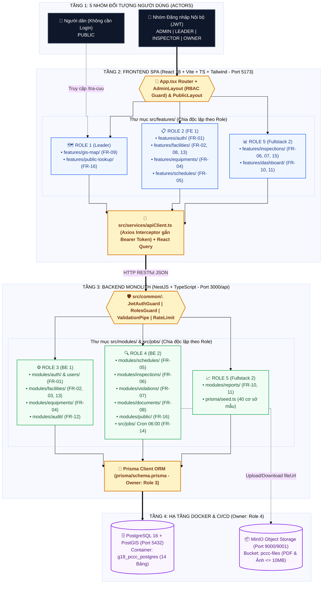
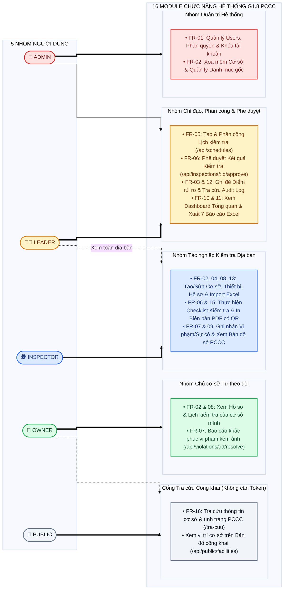
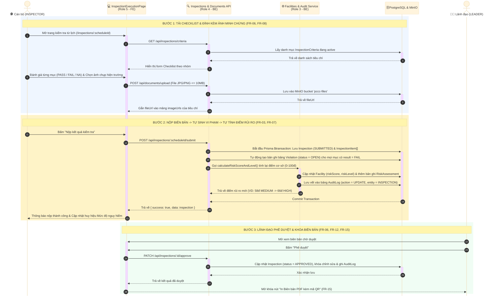
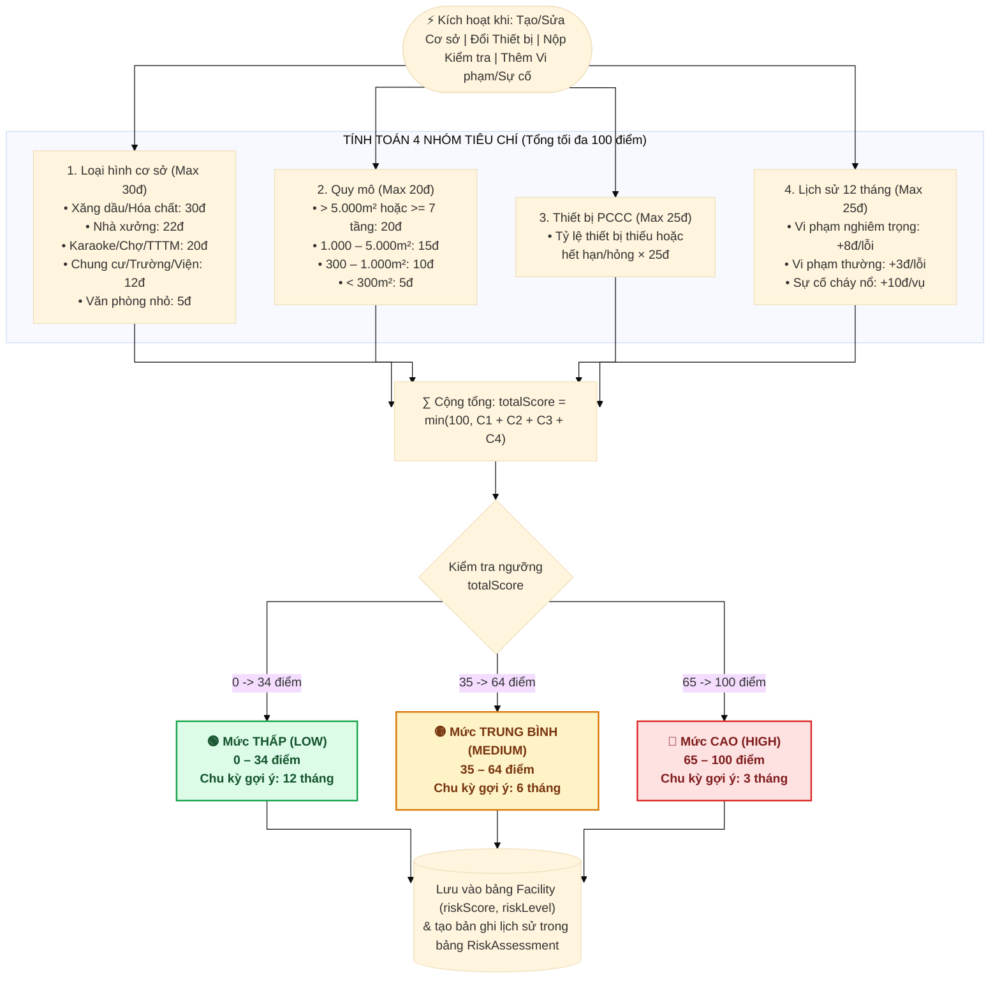
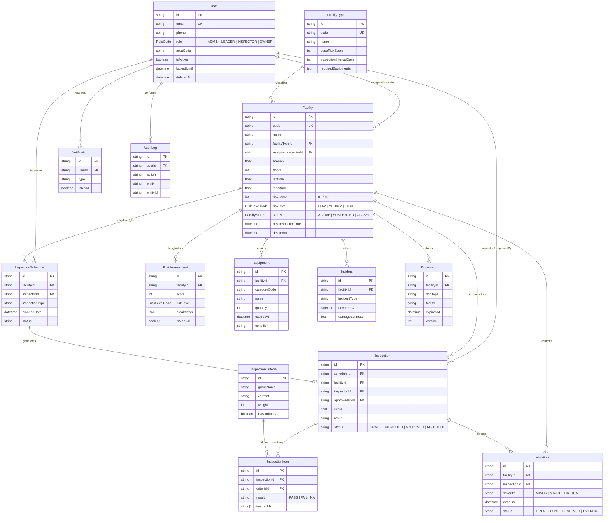

# 06. BỘ SƠ ĐỒ KIẾN TRÚC, NGHIỆP VỤ & CƠ SỞ DỮ LIỆU HỆ THỐNG G1.8 (PCCC)

Tài liệu này tổng hợp 5 sơ đồ chuẩn hóa dựa trên cấu trúc thư mục, 14 bảng Prisma và 16 module chức năng (`FR-01` -> `FR-16`) của dự án.

Anh em cài extention "Markdown Preview Mermaid Support" rồi bấm "Ctrl Shhift V" để xem sơ đồ
---

## 1. Sơ đồ Kiến trúc Tổng thể 4 Tầng & Ranh giới 5 Role (System Architecture)
*Khớp với cấu trúc thư mục tại `02_KIEN_TRUC_VA_CONG_NGHE.md` và phân công tại `04_PHAN_CONG_TASK_VA_GITFLOW.md`.*

---

## 2. Sơ đồ Phân quyền Tác nhân & Chức năng (Use Case Diagram theo FR-01 -> FR-16)
*Khớp với Ma trận RBAC tại `01_TongQuan_DeTai.md` và `05_HOP_DONG_API_VA_BAO_MAT.md`.*

---

## 3. Sơ đồ Tuần tự Luồng Kiểm tra, Tự sinh Vi phạm & Tự tính Điểm Rủi ro (Sequence Diagram)
*Khớp với các API trong `05_HOP_DONG_API_VA_BAO_MAT.md` và hàm `calculateRiskScoreAndLevel` trong `02_KIEN_TRUC_VA_CONG_NGHE.md`.*

---

## 4. Sơ đồ Lưu đồ Thuật toán Tính Điểm Nguy hiểm Cháy nổ 0–100 Điểm (FR-03 Flowchart)
*Minh họa trực quan công thức tại Mục 4 của `01_TongQuan_DeTai.md` và hàm `riskCalculator.ts`.*

---

## 5. Sơ đồ Quan hệ Thực thể 14 Bảng Cơ sở Dữ liệu (Prisma ERD Diagram)
*Khớp 100% với 14 model trong `03_CSDL_PRISMA_VA_TYPES.md`.*

